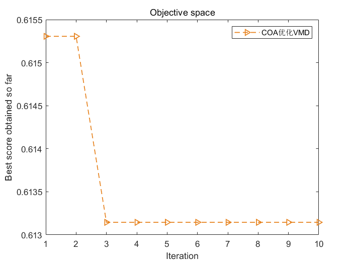
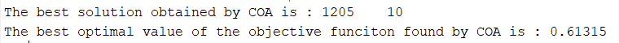

# Optimizing VMD parameters with the Raven's Algorithm, allowing for arbitrary switching of five fitness functions, including minimum entropies: sample entropy, information entropy, permutation entropy, permutation entropy/mutual information entropy

Taking the Xi'an Jiaotong University dataset as an example, select 1000 data points from X105_BA_time.mat in the 105.mat file. For those without data, refer to this article. Xi'an Jiaotong University Bearing Diagnosis Data Processing with MATLAB Free Code  
Select five fitness functions for optimization to determine the optimal k and α parameters of VMD. The four fitness functions are: minimum envelop entropy, minimum sample entropy, minimum information entropy, and minimum permutation entropy. The code allows for one-click switching between these functions. As for which fitness function to choose, you can refer to this article. Why does VMD need parameter optimization? Which among minimum envelop entropy/sample entropy/permutation entropy/information entropy is the best fit for your fitness function.

## Images

<!-- PAYMENT_BLOCK -->

## Get this dataset

- Payment link (Stripe): [Buy now](https://buy.stripe.com/3cs8yP7sY87d0vu9AB)
- Payment QR code: 

<!-- /PAYMENT_BLOCK -->
